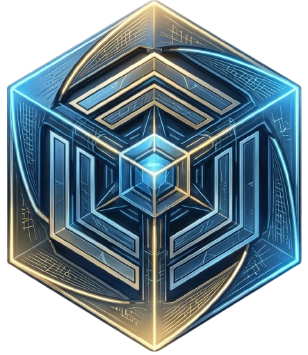

<p align="center"></p>

# NEXUS UI — Translucid Theme

A modular, object-oriented Luau UI library for Roblox script hubs. Dark glass look, live accent colour, tween animations and strict cleanup (no leaked connections or instances).

## Features

- Window with draggable header, optional resize grip, minimise (to a small restore pill) / close, show-hide keybind, logo slot
- Animated loading screen with an optional language picker (`Nexus:Load`)
- Tabs and titled sections
- Toggle, Slider, Button, Dropdown (single + multi), Keybind, Text input, Label
- Colour picker: hue ring, saturation/brightness disc, optional alpha bar, hex + RGB inputs (pure Instances, no images)
- Notifications (Info / Success / Warning / Error) with progress bar
- Live accent switching (`Window:SetAccent`)
- Flags registry: `Window.Flags.my_flag.Value`
- `Maid`-based cleanup: `Window:Destroy()` / `Nexus:Destroy()`; re-executing the script removes the old instance
- Works with `gethui` / CoreGui / PlayerGui fallback

## Quick start

```lua
local Nexus = loadstring(game:HttpGet("https://raw.githubusercontent.com/CryoStrike/NexusUI/main/init.lua"))()

local Window = Nexus:CreateWindow({
    Name = "NEXUS",
    Subtitle = "TRANSLUCID THEME",
    Icon = "https://raw.githubusercontent.com/CryoStrike/NexusUI/main/assets/nexus-ico.png",
    Accent = Color3.fromRGB(0, 170, 255),
})

local Tab = Window:CreateTab("Main")
local Section = Tab:AddSection("Controls")

Section:AddToggle({ Name = "Toggle", Default = false, Flag = "t1", Callback = function(v) print(v) end })
Section:AddSlider({ Name = "Slider", Min = 0, Max = 100, Default = 50, Callback = print })
Section:AddButton({ Name = "Notify", Callback = function()
    Window:Notify({ Title = "Hi", Content = "It works!", Type = "Success" })
end })
```

See [`examples/hub.lua`](examples/hub.lua) for a complete Main / Player / Settings hub, and
[`examples/translucid_hub.lua`](examples/translucid_hub.lua) for the full showcase: loading screen, language picker,
resizable window and the Combat / Character / Farm / Troll categories.

```lua
-- Loading screen + language picker (yields until the user presses Continue)
local language = Nexus:Load({
    Name = "NEXUS", Subtitle = "TRANSLUCID THEME", Icon = "...",
    Steps = { "Initializing", "Loading modules", "Preparing interface" }, Duration = 3,
    Languages = { "English", "Français", "Español" }, DefaultLanguage = "English",
})
if not language then return end
```

## API

| Call | Notes |
|------|-------|
| `Nexus:Load{ Name, Subtitle, Icon, Accent, Steps, Duration, ReadyText, Languages, DefaultLanguage, LanguageTitle, LanguageLabel, ContinueText }` | yields, returns the chosen language (`nil` if closed early) |
| `Nexus:CreateWindow{ Name, Subtitle, Icon, Accent, Size, ToggleKey, Theme, Resizable, MinSize, MaxSize }` | returns `Window` |
| `Window:CreateTab(name, icon?)` | returns `Tab` |
| `Tab:AddSection(name)` | returns `Section` (Tabs also accept components directly) |
| `:AddToggle{ Name, Default, Flag, Callback(bool) }` | `el:Set(v, silent?)` |
| `:AddSlider{ Name, Min, Max, Default, Increment, Suffix, Flag, Callback(n) }` | `el:Set(v, silent?)` |
| `:AddButton{ Name, Callback }` | |
| `:AddDropdown{ Name, Options, Default, Multi, Flag, Callback(v)}` | `el:Set`, `el:SetOptions(list)` |
| `:AddKeybind{ Name, Default, Callback(key), OnChanged(key) }` | click, then press a key (Backspace clears) |
| `:AddInput{ Name, Placeholder, Default, ClearOnFocus, Callback(text, enter) }` | |
| `:AddColorPicker{ Name, Default, Alpha, DefaultAlpha, Open, Flag, Callback(color, alpha) }` | `el.Value` (Color3), `el.Alpha`, `el:Set(Color3 or "#RRGGBB", silent?)`, `el:SetAlpha(n, silent?)`, `el:Open(bool?)` |
| `:AddLabel{ Text }` | `el:Set(text)` |
| `Window:Notify{ Title, Content, Duration, Type }` | |
| `Window:SetAccent(Color3)` / `Window:SetToggleKey(KeyCode)` / `Window:Toggle(bool?)` | |
| `Window:Minimize()` | hides the window and shows a small pill; click it (or press the toggle key) to restore |
| `Window:Destroy()` / `Nexus:Destroy()` | full cleanup |

Every element has `.Value`, `:Set()`, `:Destroy()` and `.Frame`.

## Logo

Pass `Icon` as `rbxassetid://<id>` (upload the logo to Roblox) or as an https URL. URLs are downloaded once to `workspace/NexusUI/` and loaded via `getcustomasset` when your environment supports it.

## Development

```lua
-- copy this repo to <workspace>/NexusUI/, then:
getgenv().NEXUS_LOCAL = true
local Nexus = loadstring(readfile("NexusUI/init.lua"))()
```

## Structure

```
NexusUI/
├─ init.lua            loader + public API
├─ src/
│  ├─ Window.lua       window shell, header, sidebar
│  ├─ Tab.lua          tabs + sections
│  ├─ Components.lua   toggle, slider, button, dropdown, keybind, input, label
│  ├─ Loader.lua       loading screen + language picker
│  ├─ Notifications.lua
│  ├─ Theme.lua        palette + live accent listeners
│  ├─ Util.lua         tweens, drag, instance helpers
│  └─ Maid.lua         cleanup
├─ examples/hub.lua
├─ examples/translucid_hub.lua
├─ assets/nexus-ico.png
├─ assets/icons/       white tab icons used by translucid_hub.lua
└─ LICENSE
```

## License

MIT
